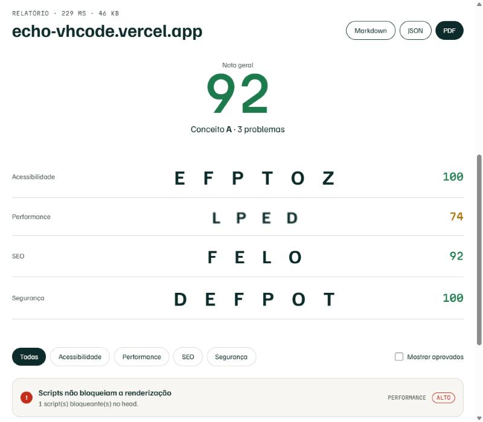

# a11y-lens

**PT** · Exame de vista para sites. Cole uma URL e receba notas de acessibilidade, performance, SEO e segurança, com a explicação e a correção sugerida para cada problema. Relatório exportável em Markdown, JSON ou PDF.
**EN** · An eye exam for websites. Paste a URL to get accessibility, performance, SEO and security scores, with an explanation and suggested fix for every issue. Export as Markdown, JSON or PDF.

🔗 **Ao vivo / Live:** https://a11y-lens-vhcode.vercel.app



## Português

### O que verifica (35 regras)
| Categoria | Exemplos |
|---|---|
| Acessibilidade | idioma, alt de imagens, rótulos de formulário, nome de botões e links, hierarquia de títulos, main, skip link, zoom bloqueado, IDs duplicados, tabindex positivo, iframes, legendas |
| Performance | tempo de resposta, peso do HTML, compressão, scripts bloqueantes, dimensões de imagem, lazy loading, scripts de terceiros |
| SEO | title, meta description, canonical, noindex, Open Graph, JSON-LD, robots.txt |
| Segurança | HTTPS, HSTS, CSP, nosniff, clickjacking, Referrer-Policy, conteúdo misto, versão do servidor exposta, cookies sem Secure/HttpOnly |

As regras seguem o catálogo do [Front-End Checklist](https://frontendchecklist.io), e cada problema tem link para a regra original. A nota de cada categoria pondera a gravidade (crítico 15, alto 10, médio 5, baixo 2).

### API
```
POST /api/v1/audits   { "url": "https://exemplo.com" }
200 { "data": Report }
400 invalid_url · 413 too_large · 422 blocked | not_html | unreachable · 429 rate_limit_exceeded · 504 timeout
```

### Segurança (o auditor também precisa ser seguro)
- **SSRF:** só http/https nas portas 80/443, sem credenciais na URL; o DNS é resolvido e qualquer IP privado, loopback, link-local, CGNAT ou metadata de nuvem é recusado
- Redirecionamentos seguidos manualmente (máx. 5), cada salto revalidado
- Timeout de 8 s, HTML limitado a 2 MB lido em stream, só `text/html`
- Rate limit por IP; nenhum resultado é armazenado
- O HTML auditado nunca é renderizado: os trechos de exemplo aparecem como texto
- Limitação conhecida: entre a checagem de DNS e a conexão existe uma janela teórica de DNS rebinding

### Stack
Next.js 16 · React 19 · TypeScript · Tailwind CSS 4 · node-html-parser · Motion · Vitest

### Como rodar
```bash
npm install
npm run dev
npm test
```

## English

35 static checks across accessibility, performance, SEO and security, based on the Front-End Checklist rules. Scores weighted by severity, each finding explains why it matters and how to fix it (with code). SSRF-hardened fetcher (DNS + private-range checks on every redirect, timeouts, size caps). Public JSON API at `POST /api/v1/audits`.
